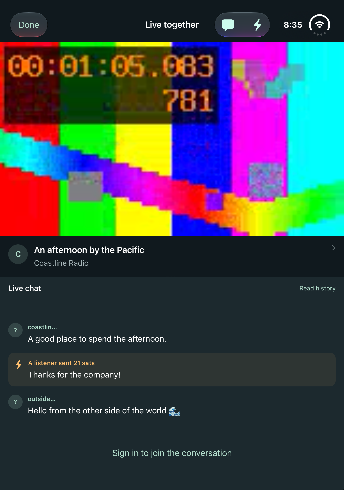
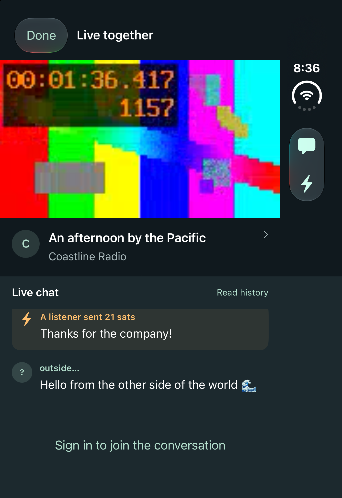

# Cove for iPhone

The `feature/iphone-app` branch adds **CoveIOS** to `nostrTV.xcodeproj`, sharing
the existing Nostr services with the Apple TV app. It targets iOS 18 or later.
The Apple TV app uses the `nostrTV` target. A fork is unnecessary: fixes to the
shared services apply to both apps.

## Run

1. Open `nostrTV.xcodeproj` in Xcode 27.1 or later for full iPhone Duo support.
2. Select the **CoveIOS** scheme and an iPhone simulator or connected iPhone.
3. For a physical device, check the development team and bundle identifier under
   Signing & Capabilities. The target uses `stream.nostrTV.ios`; this does not
   register a new App Store app or configure a universal purchase.
4. Build and run.

To compile without signing or an installed simulator runtime:

```sh
xcodebuild -project nostrTV.xcodeproj -scheme CoveIOS \
  -destination 'generic/platform=iOS' \
  -derivedDataPath /tmp/cove-ios-build CODE_SIGNING_ALLOWED=NO build
```

For an unsigned Release build, add `-configuration Release` to that command.

## Duo layout and playback

- Closed portrait places the video above the creator details and live chat.
- Open portrait keeps that same vertical arrangement and uses the wider inner
  display for video and conversation.
- Wide landscape places chat beside the video. Narrow windows and accessibility
  text sizes keep the vertical arrangement.
- Layout decisions use the available local bounds. A `PhoneWatchSession` owns
  the player, subscriptions, and message draft independently of layout changes.
- Native AVKit controls provide full screen, AirPlay, and picture in picture.
  The playback audio session and background audio capability support continued
  listening. A transient inactive scene during folding does not stop playback.

### Duo interface refinement — October 23, 2026

Search uses the system's minimized search item. On Duo's outer display and open
landscape, its bottom-toolbar placement moves the magnifying glass to the side
with the other controls. With horizontal bars it uses the top trailing placement,
so the tab bar cannot hide search. Activating it expands native search; the stream grid
does not reserve a permanent search row. The adaptable tab bar now defaults to
the compact tab presentation so browsing has more room on the inner display.
The stream grid uses even columns when multiple cards fit and aligns cards at
the top, following Apple's recommendation for balanced content across a fold.

The player has no navigation title or separate header above the picture. A
labelled back chevron replaces the text-only Done button, and the transparent
system toolbar keeps Back, Chat, and Zap reachable. The picture extends to the
top edge, with the horizontal safe area preserved for the side controls. In a
wide layout, the picture fits at the top of its column instead of being centered
inside a tall black region. Stream details remain below it and chat stays beside
it. Open portrait keeps video above chat.

In open landscape the chat column is narrower and runs beneath the system's
trailing vertical bar, giving that width to the picture. The chat header stays
clear of the bar and clock, the composer reaches the edge below the bar, and it
moves back beside the bar while the keyboard is raised. This only happens when
the leading edge has no inset, so a landscape iPhone never places chat under
the Dynamic Island. The space under the creator row shows live time, viewers,
likes, sats zapped and the top supporters.

Apple deliberately retains horizontal controls on the inner display in portrait.
Cove follows that placement, floating the native controls over the picture;
it does not force a custom right-side toolbar in that pose. Native bars also
handle the camera, overflow, accessibility, and opposite-edge placement in Split
View. Older iOS versions retain native search without the iOS 26 minimization API.

References reviewed for this refinement:

- [Designing for iPhone Duo](https://developer.apple.com/design/human-interface-guidelines/designing-for-iphone-duo)
- [Design for iPhone Duo](https://developer.apple.com/videos/play/tech-talks/111466/)
- [Raise the bar with iPhone Duo](https://developer.apple.com/videos/play/tech-talks/111462/)
- [Search toolbar behavior](https://developer.apple.com/documentation/swiftui/view/searchtoolbarbehavior(_:))
- [Placing the system search item](https://developer.apple.com/documentation/swiftui/defaulttoolbaritem/init(kind:placement:))

The custom video/chat layout still uses local window bounds to keep the portrait
arrangement stable when the keyboard opens. The new arrangement-view APIs are a
possible later replacement, but must preserve both chat visibility and the
playback session across keyboard and fold transitions.

## Phone features

Discover and Following include stream search, categories, thumbnails, and creator
profiles. The watch screen supports HLS video, live chat reading and sending,
zap receipts, and a persistent chat visibility preference. Your space includes
profile refresh and sign-out.

Sign in using a NIP-46 remote signer or an nsec stored in the Keychain. The remote
signer screen offers a `nostrconnect://` link, sharing, and a QR code. Same-device
handoff requires a compatible signer that handles that link.

The zap flow supports preset/custom amounts, a comment, Lightning invoice QR,
wallet handoff, copying/sharing an invoice, and receipt confirmation. Receipts
must match both the invoice and the Lightning service's signing key.

Credentials and preferences remain local to each app; sharing source code does
not pair a phone with an Apple TV or sync their sessions.

## What is shared

The iPhone target includes the existing `nostrTV` source folder through Xcode
target membership. Its membership exceptions exclude the TV app entry point,
TV screens, and TV asset catalog. `CoveIOS` contains the phone entry point,
touch interface, and its own asset catalog. Shared services and models remain
in one place, so fixes apply to both apps.

Chat publishing uses `LiveActivityManager.sendChatMessage(_:to:)` on both
platforms. The phone can send to the selected stream without first publishing
a viewer-presence event.

When adding a TV-only file under `nostrTV`, uncheck its CoveIOS target membership
in Xcode. Phone-only files belong under `CoveIOS`. Shared code can later move to
a local Swift package without creating a fork or copying services.

## Testing and screenshots

`CoveIOSTests` covers adaptive layout, remote signer handshake validation, and
invoice generation/receipt matching. `CoveIOSUITests` covers browsing, creator
details, chat visibility, rotation, player continuity, and message drafts. UI
tests serve a local video fixture with HTTP byte-range support; they do not
connect to relays, sign events, or make payments.

```sh
xcodebuild -project nostrTV.xcodeproj -scheme CoveIOS \
  -destination 'platform=iOS Simulator,name=Cove Duo' \
  -resultBundlePath /tmp/cove-iphone-tests.xcresult \
  CODE_SIGNING_ALLOWED=NO test
```

The native hinge test is opt-in because it requires Device Hub's **Open** and
**Closed** controls. Start with the simulator closed in portrait, then run:

```sh
TEST_RUNNER_COVE_TEST_DUO_POSES=1 xcodebuild \
  -project nostrTV.xcodeproj -scheme CoveIOS \
  -destination 'platform=iOS Simulator,name=Cove Duo' \
  -only-testing:CoveIOSUITests/PhoneNavigationTests/testDuoOpenPortraitAndClosePreservePlayback \
  -resultBundlePath /tmp/cove-duo-poses.xcresult \
  CODE_SIGNING_ALLOWED=NO test
```

When the log prints `COVE_TEST_READY_FOR_OPEN_PORTRAIT`, select **Open** in
Device Hub, then use **Rotate Right** to put the inner display in portrait when
`COVE_TEST_READY_FOR_ROTATE_PORTRAIT` appears. The test verifies video/chat order,
player identity, advancing playback time, the draft, and the keyboard layout.
At `COVE_TEST_READY_FOR_CLOSED_PORTRAIT`, use **Controls → Rotate Left** to restore
the original device pose, then select **Closed**. Screenshots of each active
display are kept in the test result bundle. Use a fresh result path for each run.

For an offline Debug preview, launch with `--cove-ui-testing`. Optional
`--cove-ui-authenticated` shows the signed-in presentation without credentials.
Playback is disabled unless the UI test supplies a loopback media URL with
`--cove-test-media`. These switches and playback probes are excluded from Release
builds, and the media fixture belongs only to the UI test target.

Physical-device acceptance still includes a real signer handoff, wallet handoff,
background playback, AirPlay, and picture in picture. Simulator fixtures verify
the UI and shared logic without completing those external flows.

## Simulator screenshots

These are actual simulator captures using the local test video and sample chat.
The [updated Duo gallery](screenshots/iphone/duo-refinement/README.md) shows the
October 23 interface refinement with compact search, edge controls and top-aligned
video in both orientations, open and closed.
The [full screenshot gallery](screenshots/iphone/gallery/README.md) includes home
and player screens for iPhone 18 Pro, Duo open, and Duo closed in both orientations.

| Open portrait | Closed portrait |
| --- | --- |
|  |  |

For an upright capture on Duo, `xcrun simctl io <device-id> enumerate` lists the
display IDs. Capture the active display with
`xcrun simctl io <device-id> screenshot --display=<display-id> screenshot.png`.
XCTest's secondary-screen PNG attachments may use the panel's raw orientation.
