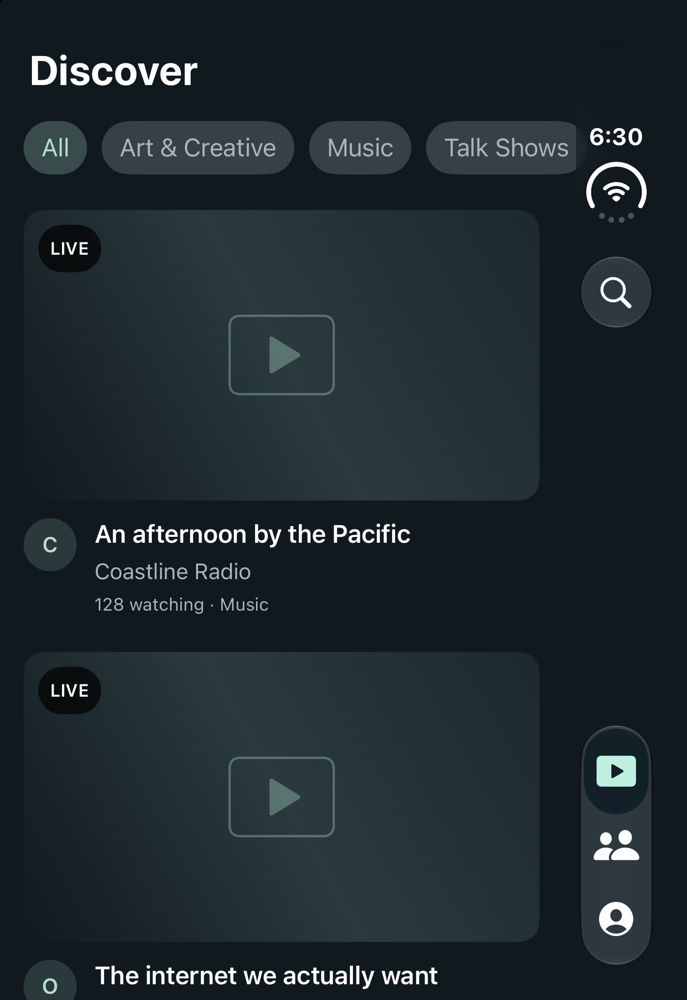
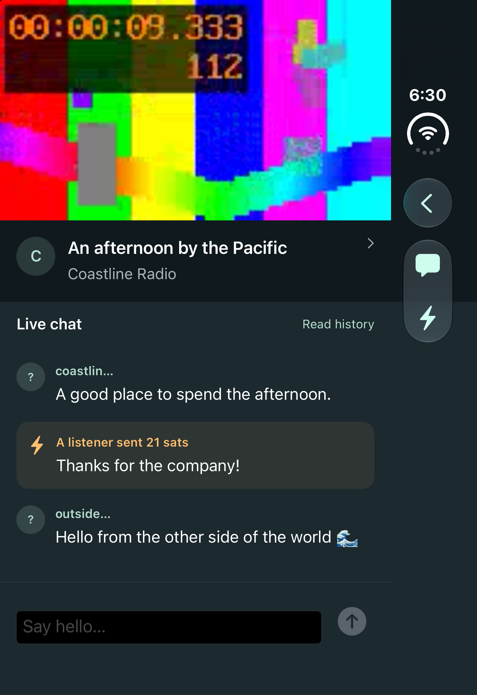

# Duo interface refinement — October 23, 2026

Actual iPhone Duo simulator captures (iOS 27.1). These use offline sample
streams/chat and a local test video. Placeholder artwork and the video test
pattern are fixtures, not live broadcasts.

Search is a magnifying glass in the native toolbar. On the outer display and
open landscape it shares the side controls; open portrait uses Apple's horizontal
toolbar placement. The player removes the separate header, replaces Done with
Back, and starts the picture at the top. Open portrait keeps video above chat.

## Open

| Screen | Portrait | Landscape |
| --- | --- | --- |
| Home |  |  |
| Player |  |  |

## Closed

| Screen | Portrait | Landscape |
| --- | --- | --- |
| Home |  |  |
| Player |  |  |

See the [implementation and Apple references](../../../IPHONE_APP.md) and
[previous gallery](../gallery/README.md) for comparison.
