# iPhone and Duo screenshot gallery

Actual simulator captures of the current `CoveIOS` app, with sample stream data,
placeholder artwork, sample chat, and the local video test pattern. No live
identity or payment was used. Click an image to open its original PNG.

## iPhone 18 Pro · iOS 27.0

| Screen | Portrait | Landscape |
| --- | --- | --- |
| Home | 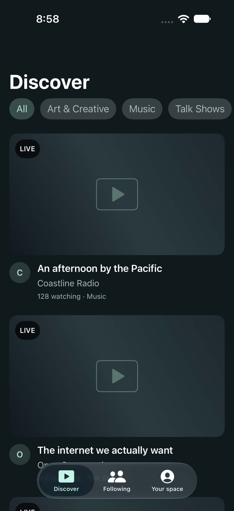 | 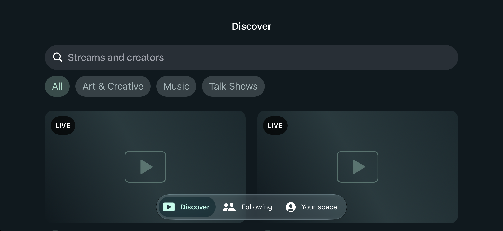 |
| Player | 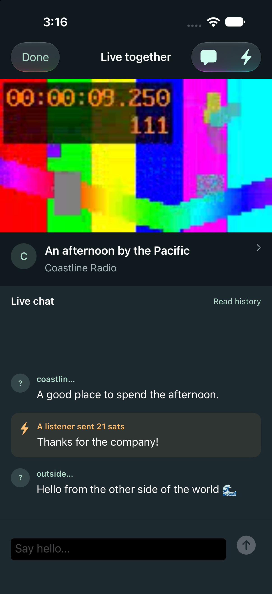 | 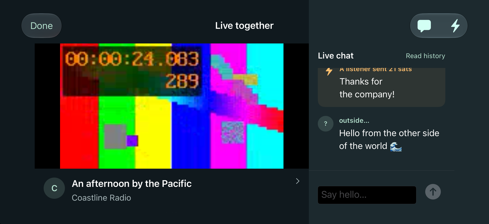 |

## Duo open · iOS 27.1

| Screen | Portrait | Landscape |
| --- | --- | --- |
| Home | 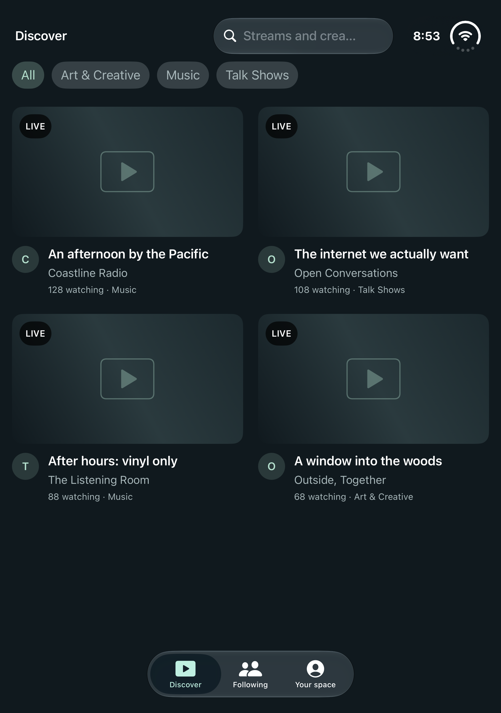 | 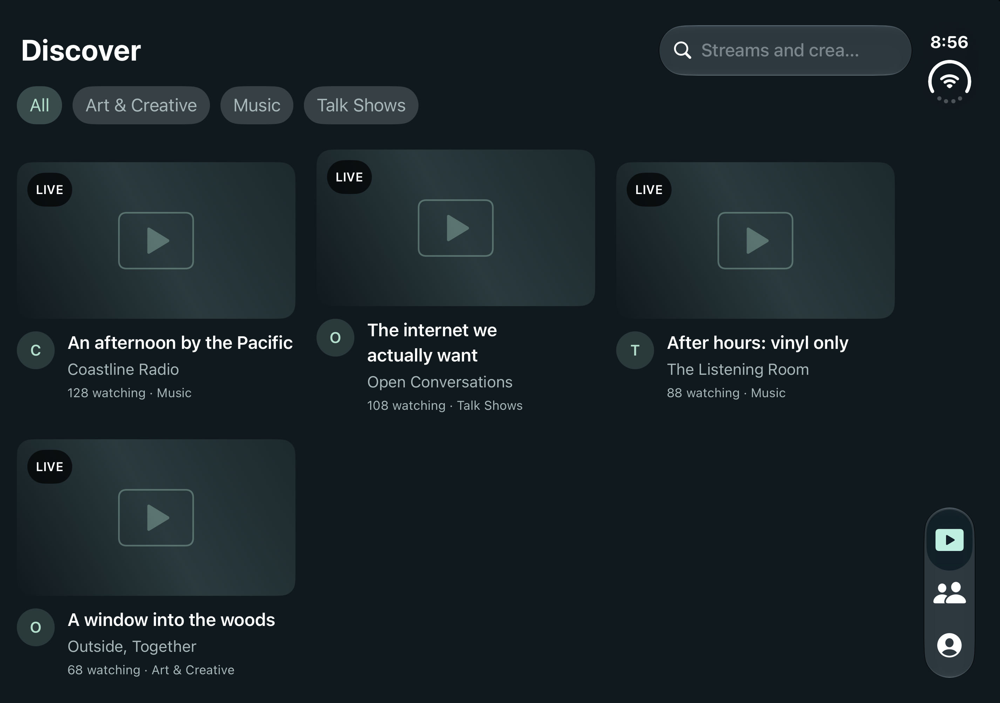 |
| Player | 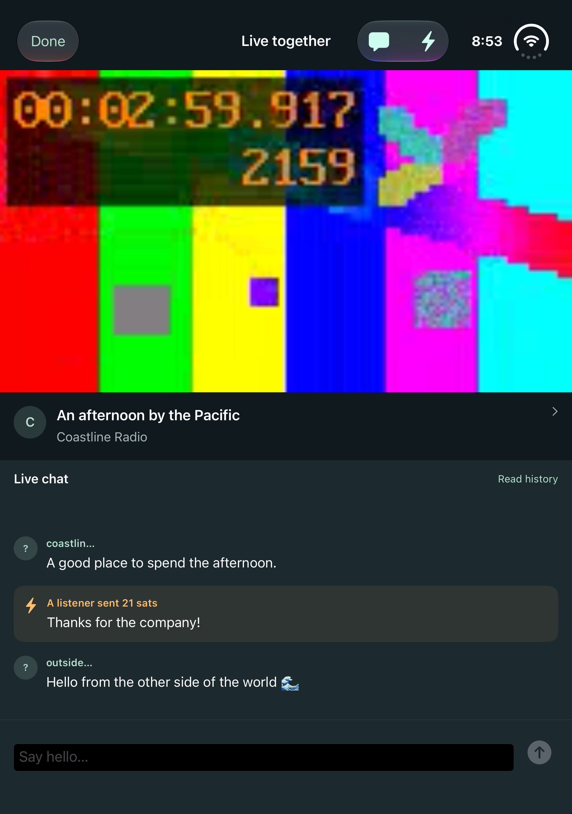 | 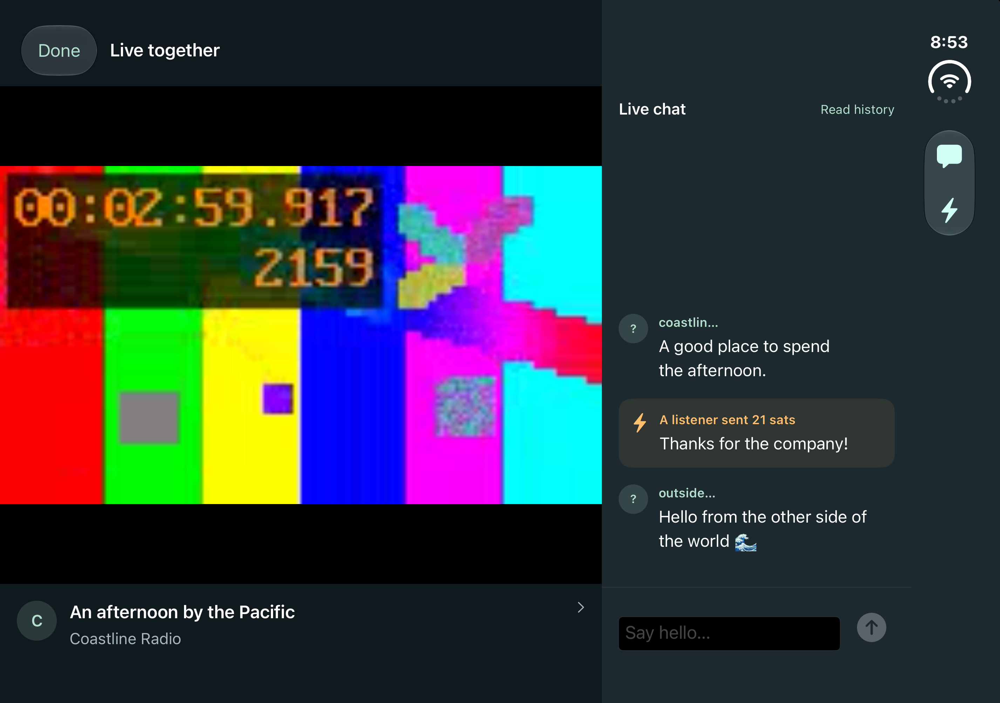 |

## Duo closed · iOS 27.1

| Screen | Portrait | Landscape |
| --- | --- | --- |
| Home | 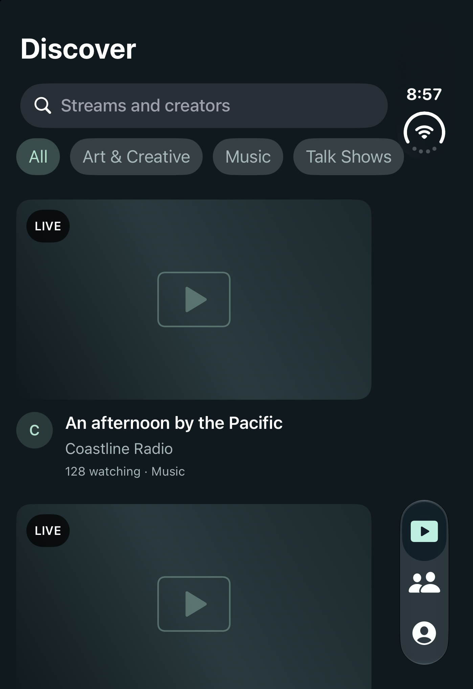 | 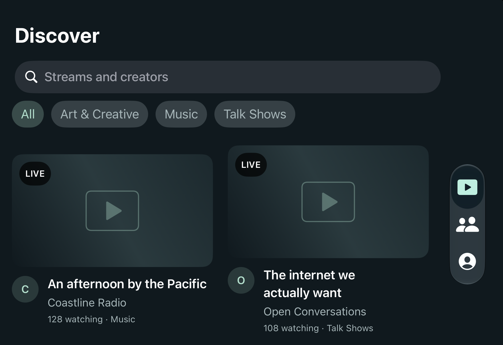 |
| Player | 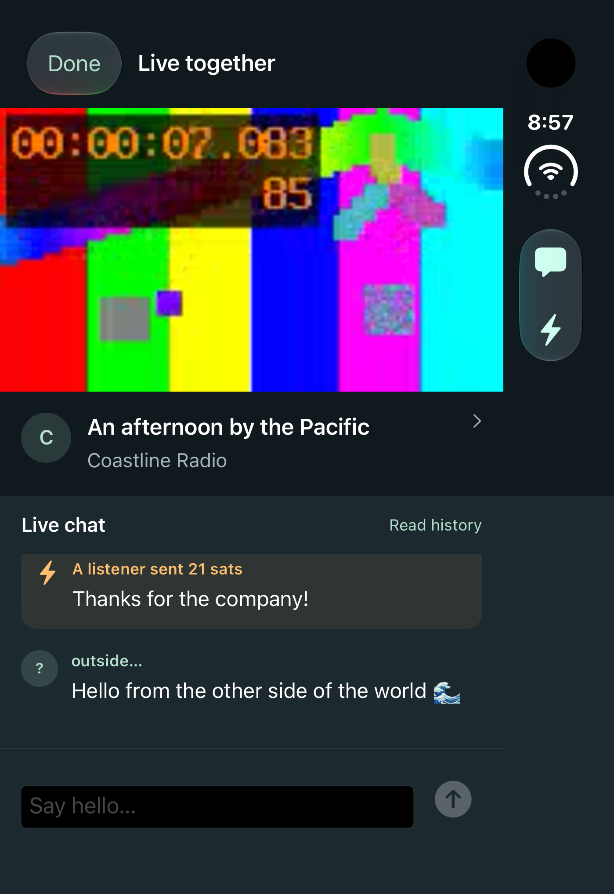 | 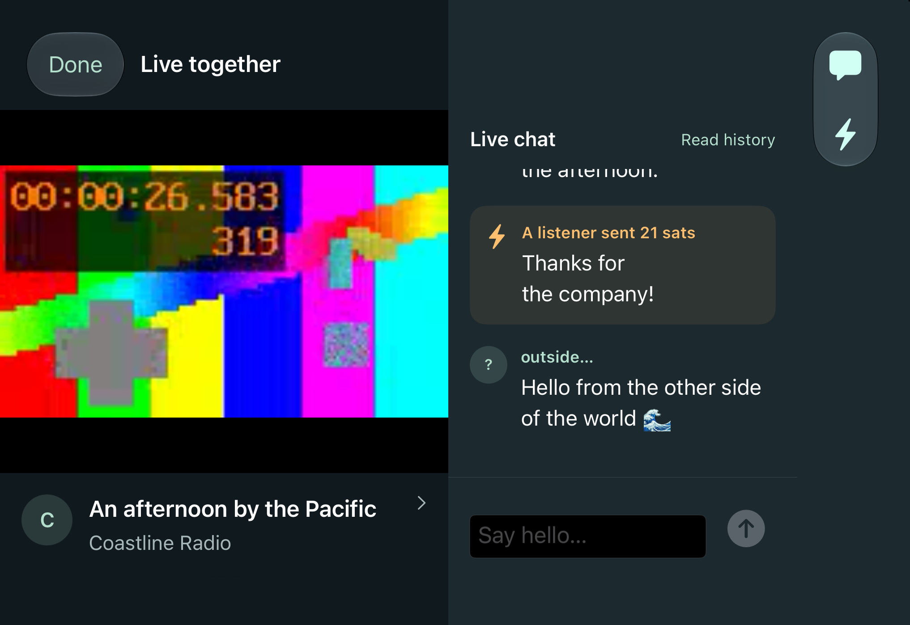 |

The iPhone runtime was added for this capture session. At the user's request,
the tvOS 18.5 runtime was removed. To free internal storage, Xcode's device-support
cache was moved to `/Volumes/Extranl Drive/Xcode/iOS DeviceSupport`, with a symlink
at `~/Library/Developer/Xcode/iOS DeviceSupport`. All 15,146 copied files were
verified before the original cache was replaced by that link.
